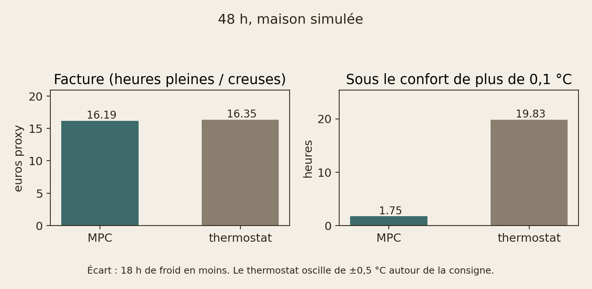

# Grey-box thermal model and heating MPC

| | |
|---|---|
| **Role** | Machine learning |
| **Domain** | Buildings |
| **Stack** |    |
| **Level** | Intermediate |
| **Status** | v1.1 |

Machine learning · Buildings · Python / NumPy / SciPy

## Objective

Infer a credible RC thermal model from real room sensors (explicit sensor
noise, Kalman filter), compare **R1C1** vs **R2C2**, then use the retained
model inside a heating MPC. The plant is not given: it is coded separately
from the identified model so closed-loop tests are not circular.

## Data

Instrumented house, 2020 (May–May), indoor temperatures at a nominal
**5 min** grid (occasional skipped samples; longest gap ~13 h). Living-room
sensor quantized at **0.1 °C**, outdoor at **1 °C**. There is **no measured
heating power nor irradiance**. Model inputs are constructed and documented:

- `P = max(T_water - T_air, 0)` when `T_air < setpoint`, else 0 (kelvin, not W)
- `S` = sum of three PV phases, negatives clipped (proxy, not W/m²)

## Result

Held-out 4 Feb–24 May 2021 (same split for both models):

- **One state**: RMSE **0.56 °C at 1 h**, **1.93 °C at 24 h**. Effective
  time constant **83 h** (the room as a single lump).
- **Two states**, inside a room box (air 0.5–6 h, walls 8–72 h, process
  noise fixed): RMSE **0.63 °C at 1 h**, **1.95 °C at 24 h**. The fit
  sits on the box: **τ_air = 6 h**, **τ_walls = 8 h**, **C_walls/C_air = 25**.
  The extra state does not reduce the error. Diagrams:
  `pictures/experiments/schema-*.png`.

Closed-loop control uses a **separate** internal model: the literature
plant **without** `α_s,mass` (air ~3 h, walls ~11 h). The living-room
fit is not the controller. The test house is not the fitted house.

Closed loop, 48 h from 18:00 local, comfort 20 °C day / 17 °C night,
peak/off-peak electricity (0.40 / 0.20 €/kWh), command = thermostat
setpoint through a 1 °C proportional band:

- **MPC**: **1.8 h** below comfort (> 0.1 °C); bill **€16.19**.
- **Hysteresis** (setpoint = comfort schedule, no model): **19.8 h**
  below; bill **€16.35**.
- Gap: **18 h** less time below comfort. The bill barely moves (**−1 %**).
  Part of the thermostat's 19.8 h is its ±0.5 °C cycle around the setpoint.
  Figures `s4`–`s6` in `pictures/experiments/` (and README).

Oracle forecasts and the proxy `P` are limitations, not a field trial.



## Limits

- Identification is one living room, one year, winter PEM window. Inside a
  room box the two-state fit sits on the boundary (6 h and 8 h) and does
  not beat the one-state model.
- Closed-loop tests use a **literature plant** (solar also on the mass), not
  the house. Weather forecasts given to the MPC are perfect (oracle).
- `P` and `S` are constructed proxies, not watts or W/m². No Docker / Airflow
  / MLflow in v1.

## Experiments

Logic lives in `src/basic_mpc/` (tested). Notebooks **call** it and
record figures as PNG in `pictures/experiments/` (`RECOMPUTE = True`
to regenerate). Kernel: `pip install -e ".[nb]"`.

| Notebook | Figures |
|---|---|
| `notebooks/00-schemas-impedance.ipynb` | RC/Kalman diagrams, plant sensor (S1), \(Z(j\omega)\) Z1/Z3 |
| `notebooks/01-identification-r1c1.ipynb` | I3, I4, S1 |
| `notebooks/02-comparaison-r1c1-r2c2.ipynb` | I1–I5, Z1–Z2, S2–S3 |
| `notebooks/03-mpc-cout-consigne.ipynb` | S4–S6 (bill € vs hours below comfort) |
| `notebooks/04-devoir-approfondi.ipynb` | H1–H10 (band *n*, step, Bode, Kalman gap, Pareto λ, delayed weather) |

The CLI is the same entry points without a kernel (`python -m basic_mpc …`).

## Reproduce

```bash
pip install -e ".[dev]"
python -m basic_mpc preprocess
python -m basic_mpc build-inputs
python -m basic_mpc simulate-plant
python -m basic_mpc identify-r1c1
python -m basic_mpc draw-schemas
python -m basic_mpc compare-r1c1-r2c2
python -m basic_mpc mpc-cout-consigne
python -m basic_mpc export-simulator
python -m basic_mpc homework-pngs
pytest
```

`mpc-cout-consigne` runs the receding-horizon controller (thermostat
setpoint, peak/off-peak bill + discomfort) against a hysteresis
thermostat on the literature plant. `draw-schemas` writes publication
RC/Kalman diagrams (PNG + PDF). `compare-r1c1-r2c2` fits R2C2 on the
same PEM window and scores 1–24 h forecasts. `identify-r1c1` fits the
one-state baseline. `simulate-plant` writes a 48 h trajectory on the
**literature plant** (solar also hits the thermal mass).
`export-simulator` writes `docs/simulator/data.json` and Z1/Z3 for the
optional RC lesson on Pages. `homework-pngs` writes the in-depth
assignment figures (H1–H10).

## Repo structure

```
brief/                 # identity, objective, thermal briefs
data/raw/              # sensor CSV (do not edit)
src/basic_mpc/         # package (tested)
notebooks/             # experiments → pictures/experiments/*.png
pictures/experiments/  # recorded figures
tests/
webapp/                # optional Streamlit lab
docs/presentations/    # Marp sources
```

French notes: `ROADMAP.md`, `JOURNAL.md`, `docs/decisions.md`,
`docs/visualisations.md`, `docs/identification-split.md`.

## Optional demos

RC lesson (no Python, GitHub Pages):
[Open the RC lesson](https://dimiphoton.github.io/basic-MPC/simulator/).

Strategy lab (local Streamlit, not the main deliverable):

```bash
pip install -e ".[sim]"
streamlit run webapp/app.py
```

## Presentations

Two audiences × two languages (Marp theme `portfolio`, HTML on GitHub Pages).
The recruiter deck is a ~6-minute pitch; the technical deck is a ~12-minute
deep dive. They diverge on purpose.

- [Recruiter overview (EN)](https://dimiphoton.github.io/basic-MPC/slides/presentation-recruteur-en.html)
- [Technical deep dive (EN)](https://dimiphoton.github.io/basic-MPC/slides/presentation-technique-en.html)
- [Présentation grand public (FR)](https://dimiphoton.github.io/basic-MPC/slides/presentation-recruteur-fr.html)
- [Présentation technique (FR)](https://dimiphoton.github.io/basic-MPC/slides/presentation-technique-fr.html)
